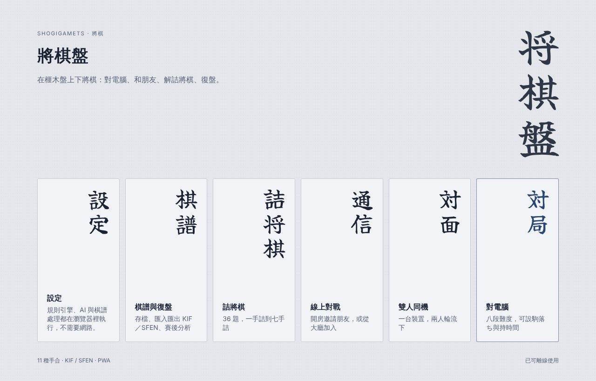
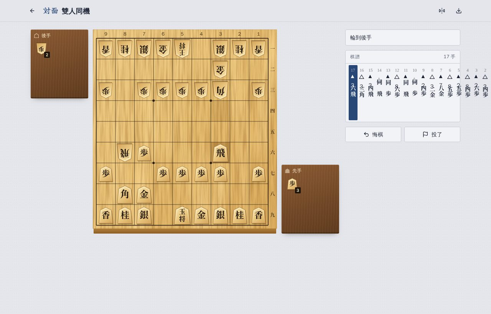
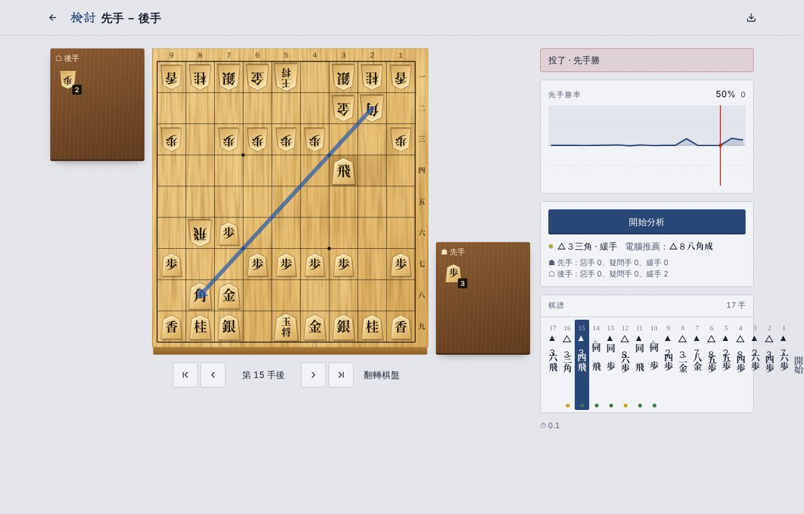
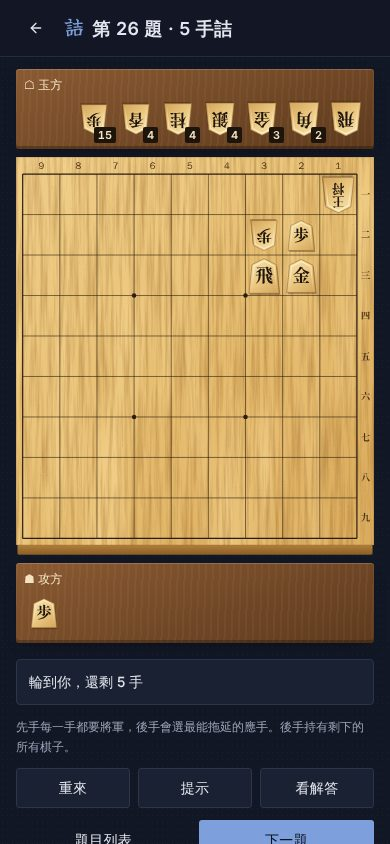

# 將棋盤 ShogiGamets

在榧木盤上下將棋的網頁遊戲：對電腦、雙人同機、線上對戰、詰將棋、復盤與賽後分析。
規則引擎、AI 與棋譜處理全部在瀏覽器裡執行，安裝成 PWA 後可以離線遊玩。



| 對局                               | 復盤與賽後分析                       | 詰將棋（手機）                               |
| ---------------------------------- | ------------------------------------ | -------------------------------------------- |
|  |  |  |

## 功能

- **對電腦**：八段難度（入門到全力），可選先手、後手或隨機。電腦在 Web Worker 裡思考，畫面不會卡。
- **雙人同機**：一台裝置輪流下，可以悔棋、翻轉棋盤。
- **線上對戰**：開房間把代碼或連結傳給朋友，或從大廳加入公開房間。支援觀戰、斷線重連、再戰（交換先後手）。
- **詰將棋**：36 題，一手詰到七手詰。主變化以外的正解也算對；守方會選最能拖延的應手。
- **復盤與賽後分析**：逐手瀏覽、形勢圖（先手勝率）、電腦推薦手的箭頭，每手標記最善、緩手、疑問手、惡手。
- **KIF／SFEN 匯入匯出**：KIF 支援手合割、BOD 盤面圖、消費時間、`同`、變化（只讀主線）；`.kif` 的 Shift_JIS 也讀得懂。SFEN 接受 USI 的 `position` 指令寫法。
- **駒落ち**：平手、香落ち、右香落ち、角落ち、飛車落ち、飛香落ち、二枚、四枚、六枚、八枚、十枚落ち，由上手先走。
- **持時間**：切れ負け、秒讀、費雪制（每手加秒），讀秒最後十秒有提示音。
- **繁體中文與英文**，深色與淺色主題，駒音以 WebAudio 合成。

### 外觀

- 棋盤是榧木的柾目（直紋），墨線與四個星，盤的側面有厚度；駒台是較深的櫸木色。
- 棋子是五角形的黃楊木駒，依棋種大小不同（王最大、步最小），成駒用朱字，王將分「王將」與「玉將」。
  字型是 Shippori Mincho B1 的子集，接近錦旗書體。
- 直書：大廳的選單是一排直書短冊，棋譜以直書由右往左排列、手數以縱中橫顯示，終局的「先手の勝ち」也是直書。
- 棋子移動時會滑過去，打入時落下，升變時翻面；可以點選，也可以拖曳。

## 快速開始

需要 Node.js 22 以上。

```bash
npm install
```

```bash
npm run dev
```

開發伺服器預設在 <http://localhost:5173/>。

## 指令

| 指令                      | 用途                                                            |
| ------------------------- | --------------------------------------------------------------- |
| `npm run dev`             | 開發伺服器                                                      |
| `npm run build`           | 正式版建置，輸出到 `dist/`                                      |
| `npm run preview`         | 預覽 `dist/`                                                    |
| `npm test`                | 單元測試（node:test）：規則、棋譜、持時間、詰將棋、AI、線上規則 |
| `npm run test:e2e`        | 端對端測試（Playwright），會自動建置 e2e 版並啟動預覽伺服器     |
| `npm run typecheck`       | TypeScript 型別檢查                                             |
| `npm run format`          | Prettier 排版                                                   |
| `npm run check`           | 型別、排版、單元測試、建置一次跑完                              |
| `npm run generate:tsume`  | 重新產生詰將棋題庫（約兩分半鐘）                                |
| `npm run generate:icons`  | 重新產生 PWA 圖示                                               |
| `npm run smoke -- <網址>` | 部署後的驗收（見「部署」）                                      |

第一次跑端對端測試前要安裝瀏覽器：

```bash
npx playwright install chromium
```

## 技術

- 介面：React 19、Vite、Tailwind CSS 4。
- shadcn/ui 只用在外圍介面（設定、大廳、對話框），共 8 個元件：`button`、`card`、`dialog`、`input`、
  `radio-group`、`select`、`switch`、`tabs`，外觀都改成自訂主題（藍染紙色、方角、下劃線分頁）。
- 棋盤、棋子、駒台、形勢圖與所有動畫都是自己寫的 SVG。
- 測試：node:test 跑單元測試，Playwright 跑端對端測試，GitHub Actions 每次推送都會全部跑一次。

## 架構

```
ui (views/ board/ components/)  ──▶  state/  ──▶  core/
                                       │           ▲
                                       ├──▶ ai/ ───┤
                                       └──▶ online/┘
```

- `src/core/`：規則引擎，純 TypeScript，不依賴 UI、網路或儲存。原有的 `position.ts`、`game.ts`、
  `move.ts`、`notation.ts`、`types.ts` 保持原樣；新增的 `record.ts`（KIF／SFEN）、`handicap.ts`、
  `clock.ts`、`mate.ts`（詰み探索）、`tsume.ts` 也都是純函式或純類別。
- `src/ai/`：內建引擎與 USI 協定層，只依賴 `core/`。
- `src/online/`：線上房間，`session.ts` 只認得 `RoomBackend` 介面，不知道 Firebase 的存在。
- `src/state/`：把上面組成一盤棋（`LocalMatch`、`OnlineMatch`），畫面只跟它互動。

詳細說明與常見修改方式見 [docs/architecture.md](docs/architecture.md)。

### AI 與 YaneuraOu

內建引擎是反覆加深的 alpha-beta（PVS、置換表、空著剪枝、遲著減深、殺手手與歷史表、將軍延伸、靜止搜尋），
評估子力、持駒、位置與王將安全度。低難度用「淺讀＋分數加雜訊」降低棋力，所以會犯人類式的錯而不是亂走，
但一定看得到一手詰。

引擎在 Web Worker 裡**講 USI 協定**，主執行緒的 `UsiEngine` 也只認 USI。換成 YaneuraOu 時不必改畫面或分析的程式：

1. 準備一個講 USI 的 YaneuraOu Worker 腳本（例如 WASM 版），透過 `postMessage` 收送 USI 文字行。
2. 建置時設定環境變數 `VITE_YANEURAOU_URL` 指向那個腳本。
3. 設定畫面就會出現「AI 引擎」選項。難度透過 USI 的 `SkillLevel` 選項傳遞，YaneuraOu 也支援。

### 線上對戰的資料設計

沿用 GomokuGamets 的做法，用 Firebase Realtime Database 加匿名登入：

- **棋步只能附加**：`moves/<i>` 與手數 `n` 一起用多路徑原子更新寫入，規則禁止改寫已存在的棋步。
- **勝負不存資料庫**：雙方都從棋步重演出結果，沒有任何欄位可以「寫入自己贏了」，唯一能寫的結局是自己認輸。
- **持時間也由重演得出**：每一手帶伺服器時間戳，規則強制 `t === now`，不能偽造。時鐘與超時都從時間戳算，
  雙方結論一致；超時之後才送出的棋步重演時不算。
- **規則擋不到的不合法資料**（例如只加手數不落子、不合法的棋步）由重演判該方負。
- 規則寫在 `database.rules.json`。`tests/helpers/rules-db.ts` 會真的載入這個檔案逐條求值，
  `tests/online.test.ts` 的每次寫入都經過規則，包含各種作弊情境。它模擬的是規則語意，不是 Firebase 官方引擎，
  大改規則後請到 Firebase Console 的 Rules Playground 再確認一次。

## 部署

照順序做完這四步。每個平台的逐步操作、畫面上的選項怎麼填、背後的原理與疑難排解，見 [docs/deployment.md](docs/deployment.md)。Firebase 可以晚點再設：沒有設定時其他模式照常，線上對戰會顯示「尚未設定」。

### 1. 分支

正式版分支是 `main`：推送到 `main` 時，Cloudflare Pages 會自動部署正式網址；推送到其他分支則產生預覽網址。
CI（`.github/workflows/ci.yml`）在每個分支的推送與每個 PR 都會跑。日常修改建議開分支、走 PR，測試通過再合併到 `main`。

### 2. Firebase（線上對戰）

1. 在 [Firebase Console](https://console.firebase.google.com/) 建立專案，啟用 **Authentication → 登入方式 → 匿名**，
   並建立 **Realtime Database**（地區任選，網址之後要用）。
2. 部署資料庫規則（含 `createdAt` 索引，大廳查詢需要它）：

   ```bash
   npx firebase-tools deploy --only database --project <你的專案 ID>
   ```

3. 在「專案設定 → 一般 → 你的應用程式」新增網頁應用程式，把設定值抄下來，對應到 `.env.example` 裡的變數：

   ```
   VITE_FIREBASE_API_KEY=...
   VITE_FIREBASE_AUTH_DOMAIN=<專案>.firebaseapp.com
   VITE_FIREBASE_DATABASE_URL=https://<專案>-default-rtdb.<區域>.firebasedatabase.app
   VITE_FIREBASE_PROJECT_ID=<專案>
   VITE_FIREBASE_APP_ID=...
   ```

   本機測試時複製成 `.env.local`（已列在 `.gitignore`）。

這些值會出現在每個訪客的瀏覽器裡，本來就不是祕密，資料安全由 `database.rules.json` 把關。
如果你在 Google Cloud 對 API 金鑰設了「HTTP 參照網址」限制，要把 `*.pages.dev` 與自訂網域加進去。
Firebase SDK 只在進入線上對戰時才動態載入，單機模式不會下載。

### 3. Cloudflare Pages

在 Cloudflare Pages 連接這個 GitHub 儲存庫：

| 項目     | 值                                    |
| -------- | ------------------------------------- |
| 框架預設 | 無（None）                            |
| 建置指令 | `npm run build`                       |
| 輸出目錄 | `dist`                                |
| Node.js  | 自動讀取 `.nvmrc`（22），不必另外設定 |
| 環境變數 | 上一步的 `VITE_FIREBASE_*`            |

- 環境變數在建置時讀進程式，**改完要重新部署**才會生效。「正式版」與「預覽」的變數是分開設定的。
- 路由用網址雜湊（`#/play`、`#/r/ABC234`），不需要設定轉址。
- `public/_headers` 讓 `sw.js` 與 `index.html` 不被快取、`assets/` 長期快取。
- 所有路徑都是相對路徑，部署在子目錄或自訂網域都能運作。

### 4. 驗收

部署完成後，對網址跑驗收腳本（需要 `npx playwright install chromium`）：

```bash
npm run smoke -- https://<專案>.pages.dev
```

它會檢查首頁、`_headers` 有沒有生效、manifest 與圖示、Service Worker、離線重新整理，以及 Firebase 是否設定。
設好 Firebase 之後加上 `--online`，會實際匿名登入並讀取大廳；再加 `--write` 會真的開一間私人房間再刪掉，
確認資料庫規則允許寫入：

```bash
npm run smoke -- https://<專案>.pages.dev --online --write
```

`✗` 會附上原因，例如 `auth/api-key-not-valid`（金鑰填錯）、`PERMISSION_DENIED`（規則沒部署或匿名登入沒開）。
`_headers` 的效果已經用 Cloudflare 的 `wrangler pages dev` 在本機驗證過。

## PWA 與離線

建置時 `vite.config.ts` 會產生 `sw.js`，把這次輸出的所有檔案（含字型、圖示、manifest）列進預先快取。
頁面走網路優先，部署新版後下次開啟就會更新；資源快取優先，離線時整個 App 都能用（線上對戰除外）。
端對端測試裡有一項會在離線狀態重新整理，確認仍能進入詰將棋。

## 測試

- `tests/rules.test.ts`、`tests/position.test.ts`：規則引擎（含 perft 深度 4 = 719,731）。
- `tests/record.test.ts`：KIF／SFEN 往返、一般軟體輸出的 KIF、駒落ち、BOD。
- `tests/clock.test.ts`：三種持時間與重演。
- `tests/tsume.test.ts`：每一題都驗證「正好 N 手詰、沒有更短的解、主變化以將死結束」。
- `tests/engine.test.ts`：AI 的走法產生與 core 一致、戰術、逾時後局面還原、USI 通道與取消、各難度自我對弈全程合法。
- `tests/match.test.ts`：對局控制（輪流、悔棋、電腦回應、切れ負け超時、投了）。
- `tests/online.test.ts`：每一次寫入都經過資料庫規則，涵蓋輪流、駒落ち、超時、作弊、大廳、再戰。
- `e2e/`：點選與拖曳走子、升變、打入、悔棋、對電腦、投了與分析、語言切換、詰將棋、棋譜匯入、
  兩個分頁的線上對戰與再戰、離線。e2e 版用 localStorage 與 BroadcastChannel 模擬 Firebase。

## 授權與素材

- 棋子與裝飾字型是 Google Fonts 的子集（SIL Open Font License 1.1），見 `src/assets/fonts/LICENSE.md`。
- 榧木紋理、棋子、圖示都是程式產生的 SVG，沒有使用外部圖片。
